# HRB Chatbot Service

An HR benefits chatbot backed by a RAG pipeline over the Amazing Bank benefits
knowledge base (`resources/kb_docs/`). Built AI-agent-assisted under a
spec-first process (a PreToolUse hook blocks code changes without a written
spec; implementer/reviewer subagents execute and check each phase), one
feature at a
time, to apply RAG concepts from the Interview Kickstart FDE cohort - see
[docs/agent-reference/RAG-ROADMAP.md](docs/agent-reference/RAG-ROADMAP.md) for the phase-by-phase plan and
current status (that file is the source of truth for "what's done" - this
README doesn't repeat it).

**2026-10-23: now one of 8 repos**, not the whole system - this repo is still
the live production backend for retrieval traffic, but `hrb_api_gateway_service`
now fronts everything, and `hrb_rag_ingestion_service`/`hrb_rag_retrieval_service`/
`hrb_platform_components` have split off functionality into their own
deployed services (see
[microservices-rollout-plan.html](https://github.com/rvsree/hrb_emp_assist/blob/master/docs/architecture/microservices-rollout-plan.html)
in the shared `hrb_emp_assist` repo for the full current status - GitHub
shows `.html` docs as raw source, not a rendered page; see
["Viewing the architecture docs"](#viewing-the-architecture-docs) below for
where they actually render). This repo's own retrieval code stays live until
`hrb_rag_retrieval_service`'s own cutover is approved - a separate, later decision.

## Live demo

This is the backend behind **[hrb-chatbot-ui.rvsree.dev](https://hrb-chatbot-ui.rvsree.dev)**
- log in as any persona from
[docs/agent-reference/KNOWN-PERSONAS.md](docs/agent-reference/KNOWN-PERSONAS.md)
(e.g. `EMP052` / Eddy Employee / employee) and ask a benefits question. App
Runner pauses this service by default for cost control - a slow first
response means it's resuming, not broken.

### Viewing the architecture docs

This repo's `.html`/`.drawio` architecture docs (and the shared ones in
`hrb_emp_assist`) **render correctly only through the live Admin
Dashboard's docs viewer, or opened directly in a browser/draw.io** -
GitHub's own file preview always shows these as raw source text, never a
rendered page (confirmed: GitHub forces `Content-Type: text/plain` on
every raw file, including `.html`, as an anti-XSS measure - it isn't a bug
in this project). To see them rendered: log in to the live demo's Admin
Dashboard as `ADM001` (per `docs/agent-reference/KNOWN-PERSONAS.md`) and
open the **Architecture Docs** tab, or clone the repo and open the file
locally.

## Tech Stack

```mermaid
flowchart TD
    HUB((hrb_chatbot_service))
    HUB --> FW[Framework]
    HUB --> AI[AI / RAG]
    HUB --> VDB[Vector DB]
    HUB --> MDB[Metadata DB]
    HUB --> GR[Guardrails]
    HUB --> LLM[LLM Providers]
    HUB --> EVAL[Evaluation]
    HUB --> DEP[Deployment]

    FW --> FW1[FastAPI]
    FW --> FW2[Uvicorn]
    FW --> FW3[Pydantic v2]

    AI --> AI1[LangChain]
    AI --> AI2[LangGraph]
    AI --> AI3[langgraph-checkpoint-postgres]

    VDB --> V1[ChromaDB - dev]
    VDB --> V2[Pinecone - prod]

    MDB --> M1[SQLite - dev]
    MDB --> M2[Postgres/Neon - prod]

    GR --> G1[NeMo Guardrails]
    GR --> G2[Presidio]
    GR --> G3[spaCy]

    LLM --> L1[OpenAI]
    LLM --> L2[Anthropic]
    LLM --> L3[OpenRouter]

    EVAL --> E1[DeepEval]
    EVAL --> E2[LLM-judge scoring]

    DEP --> D1[AWS App Runner]
    DEP --> D2[Docker - 2-stage build]
    DEP --> D3[ECR + Secrets Manager]

    classDef hub fill:#4C1D95,color:#fff,stroke:#2E1065,stroke-width:2px
    classDef fw fill:#1D4ED8,color:#fff,stroke:#1E3A8A
    classDef ai fill:#047857,color:#fff,stroke:#064E3B
    classDef vdb fill:#B45309,color:#fff,stroke:#78350F
    classDef mdb fill:#0E7490,color:#fff,stroke:#164E63
    classDef gr fill:#BE185D,color:#fff,stroke:#831843
    classDef llm fill:#9333EA,color:#fff,stroke:#581C87
    classDef eval fill:#7C3AED,color:#fff,stroke:#4C1D95
    classDef dep fill:#475569,color:#fff,stroke:#1E293B

    class HUB hub
    class FW,FW1,FW2,FW3 fw
    class AI,AI1,AI2,AI3 ai
    class VDB,V1,V2 vdb
    class MDB,M1,M2 mdb
    class GR,G1,G2,G3 gr
    class LLM,L1,L2,L3 llm
    class EVAL,E1,E2 eval
    class DEP,D1,D2,D3 dep
```



## What this repo demonstrates

For someone evaluating this cold rather than setting it up: this is where
the RAG/agentic engine actually lives - the code every other service's own
copy was built from.

- **3 interchangeable answer modes**: direct retrieve-then-generate,
  single-agent ReAct tool-calling, and a multi-agent planner → domain-agent
  → reviewer graph (LangGraph) - same question, three distinct architectures,
  switchable per request.
- **Conversation memory** across turns (Redis-backed STM, Postgres-backed
  long-term capture of high-quality answers) - not a stateless Q&A bot.
- **Human-in-the-loop workflow**: a multi-day unpaid-leave approval -
  request filed, an `hr_support` identity resolves it (approve/reject) days
  later, the employee is emailed the outcome, the conversation resumes
  exactly where it left off.
- **Input/output guardrails** and a shared evaluation harness (golden
  dataset, release-gate CI check, live-query quality sampling) running on
  every query, not bolted on after the fact.
- **Retrieval quality**: LLM-based reranking (one call per batch, fails
  safe to the original order) before any generation step sees a retrieved
  chunk; single-agentic-rag's tool-calling loop validates every proposed
  tool call against its own real schema before it runs, feeding a
  malformed call back to the model as a correctable error instead of a
  silent failure.
- **Built via Spec-Driven Development** - every non-trivial change has a
  written spec before code, reviewed, then implemented; the full phase-by-
  phase history is in [docs/agent-reference/RAG-ROADMAP.md](docs/agent-reference/RAG-ROADMAP.md),
  not reconstructed after the fact.
- **995+ tests**, zero requiring a real API key or network call - every
  external client is faked with the exact same method signature as the
  real one.

## Diagrams and cross-service docs

**Moved 2026-10-26**: platform-level docs (architecture, diagrams, auth,
build-and-deploy) now live one level up, at `hrb_emp_assist/docs/` - a
**separate GitHub repo** from this one, this repo keeps only its own
service-specific docs under `docs/dev-reference/hrb_chatbot_v3/`. The
links below point into that sibling repo (see
["Viewing the architecture docs"](#viewing-the-architecture-docs) above
for why they show as raw source on GitHub).

Start at
[platform-overview.html](https://github.com/rvsree/hrb_emp_assist/blob/master/docs/architecture/platform-overview.html)
- the one-page hub: business capabilities, all 8 repos, one diagram, links
to everything else. Every application's own current-state, target-state
(scaling), and deployment architecture - as real, editable `.drawio` files,
not static images - is indexed at
[docs/architecture/diagrams/README.md](https://github.com/rvsree/hrb_emp_assist/blob/master/docs/architecture/diagrams/README.md).
This repo's own 3 diagrams:
[current state](https://github.com/rvsree/hrb_emp_assist/blob/master/docs/architecture/diagrams/hrb-chatbot-service-current-state-architecture.drawio),
[target state](https://github.com/rvsree/hrb_emp_assist/blob/master/docs/architecture/diagrams/hrb-chatbot-service-target-state-scaling-architecture.drawio),
[deployment](https://github.com/rvsree/hrb_emp_assist/blob/master/docs/architecture/diagrams/hrb-chatbot-service-deployment-architecture.drawio).

## Environments

| App | Local | AWS (production) |
| --- | --- | --- |
| Backend (this repo, `hrb_chatbot_service`) | `http://127.0.0.1:8093` | `https://hrb-chatbot.rvsree.dev` |
| Gateway (`hrb_api_gateway_service`, separate repo - the public entry point now) | `http://127.0.0.1:8100` | `https://necxf9n7mv.us-east-1.awsapprunner.com` |
| Frontend (`hrb_chatbot_ui`, separate repo) | `http://localhost:5173` (`npm run dev`) | `https://hrb-chatbot-ui.rvsree.dev` |
| MCP server (`hrb_lms_mcp`, separate repo - leave balance/history tools) | `http://127.0.0.1:8190` | `https://hrb-lms-mcp.rvsree.dev` |

The AWS backend runs on App Runner (Phase 10, see
[AWS-DEVOPS-RUNBOOK.md](docs/agent-reference/AWS-DEVOPS-RUNBOOK.md)); the AWS
frontend is a static build on S3 behind CloudFront, with a CI/CD pipeline
live as of 2026-10-23 (build -> S3 sync -> CloudFront invalidation on
every push to its own `master`); `hrb_lms_mcp` is its own App Runner service
with its own `deploy.yml`. As of 2026-10-23, the frontend's own
`.env.production` points at the **Gateway**, not this backend directly - the
Gateway forwards 1:1 to this backend's `BACKEND_SERVICE_URL` secret. This
backend's CORS config (`main.py`) still allows the production frontend
origin directly too (unchanged, in case anything still calls it that way),
and its `HRB_LMS_MCP_URL`/OAuth2 settings (App Runner secrets, not committed
anywhere) point at the production MCP server.

## Prerequisites

- **Python 3.12** - not 3.13/3.14. `chromadb` depends on Pydantic v1
  internals that Python 3.13 removed.
- An **OpenAI API key** at minimum (`OPENAI_API_KEY` in `.env`). Anthropic
  and OpenRouter keys are optional - the app runs fully on OpenAI alone.

## 1. Running locally, from a terminal

The venv already exists at `.venv/`. From the repository root:

```powershell
# install (only needed after requirements.txt changes)
.venv\Scripts\python.exe -m pip install -r requirements.txt

# run
.venv\Scripts\python.exe -m uvicorn src.hrb_chatbot.main:app --reload --port 8093
```

Confirm it came up:

```powershell
curl http://127.0.0.1:8093/health
```

`200` with `"status":"healthy"` means it's ready. `/docs` gives the
interactive Swagger UI.

Note the import root: everything is written as `from src.hrb_chatbot....`,
not `from hrb_chatbot....` - `src/__init__.py` exists on purpose, and the app
is always run as a module from the repository root, never from inside `src/`.

## 2. IntelliJ IDEA / PyCharm - run & debug configurations

Needs the **Python** plugin (Community edition has it; PyCharm ships with it
built in).

### Setup - once per machine

1. **Point the project at the venv.** *File → Project Structure → SDKs → +
   → Add Python SDK → Existing environment*, then choose
   `...\hrb_chatbot_service\.venv\Scripts\python.exe`. Assign that SDK to the
   module.
2. **Mark the repository root as the Sources Root** (not `src/`). Right-click
   the repo root → *Mark Directory as → Sources Root*. This is what makes
   `from src.hrb_chatbot...` resolve - marking `src/` itself instead makes
   every import underline red even though the code runs fine from a terminal.

### Run configuration - "hrb-chatbot-server"

*Run → Edit Configurations → + → Python*:

| Field | Value |
|---|---|
| Name | `hrb-chatbot-server` |
| Run target | `Module name` (switch the radio from *Script path*) |
| Module name | `uvicorn` |
| Parameters | `src.hrb_chatbot.main:app --reload --port 8093` |
| Working directory | the repository root |
| Python interpreter | the project SDK (`.venv`) |
| Environment variables | *(leave empty - `.env` is loaded by the app itself)* |

### Debug configuration - "hrb-chatbot-debug"

Duplicate the run configuration above and **delete `--reload`**. That's the
only difference - `--reload` runs the app in a child process, which breaks
an attached debugger.

## 3. Testing the endpoints

### Health - every backend service currently wired up

```powershell
# just confirms the process is up - no network call, no cost
curl http://127.0.0.1:8093/ping

# the actual diagnostic - one free, live call per service (no chat completion, no tokens spent)
curl http://127.0.0.1:8093/health

# check a specific LLM provider
curl "http://127.0.0.1:8093/health?provider=anthropic"
curl "http://127.0.0.1:8093/health?provider=openrouter"
```

`/health` reports three checks - `llm` (whichever provider you asked for,
`openai` by default), `vector_database` (`chromadb` by default, pass
`vector_provider=pinecone` to check the other), and `metadata_database`
(`sqlite` by default, pass `metadata_provider=postgres` to check the
other). **Tavily has a client
(`common/clients/web_client/tavily_client.py`) but is not wired into
`/health` yet** - a known gap, tracked in
[docs/agent-reference/BACKLOG.md](docs/agent-reference/BACKLOG.md), not something broken.

### Upload documents, index them, and ask the knowledge base

All of these are implemented and verified live (see
[docs/agent-reference/TESTING-GUIDE.md](docs/agent-reference/TESTING-GUIDE.md) for the automated test
suite, and `postman/hrb_chatbot.postman_collection.json` for every
request/response case, happy path and edge case, importable into Postman):

```powershell
# upload a PDF - chunks, embeds, and indexes in the same call (no
# separate index step since Phase 26); identity travels as a JSON string in
# the payload form field, not headers - copy the document_id from the response
curl -F "files=@resources/kb_docs/AmazingBank_Healthcare_Benefits.pdf;type=application/pdf" -F "payload={\"user_profile\": {\"employee_id\": \"EMP051\", \"full_name\": \"Hana Support\", \"role\": \"hr_support\"}}" http://127.0.0.1:8093/v1/genai-rag/ingest-document/documents

# ask a question - live retrieval + grounded generation (this spends: one
# embedding call + one chat completion). Input/output guardrails and
# conversation memory run on every call (Phase 98's shared guarded-pipeline
# core) - see docs/agent-reference/RAG-ROADMAP.md for exactly what's in
curl -X POST http://127.0.0.1:8093/v1/genai-rag-retrieval/query -H "Content-Type: application/json" -d "{\"user_profile\": {\"employee_id\": \"EMP052\", \"full_name\": \"Eddy Employee\", \"role\": \"employee\"}, \"query\": \"How many weeks of parental leave do I get?\"}"
```

Re-uploading identical PDF content is content-hash deduped (Phase 16) -
the second upload resolves to the existing document instead of creating a
duplicate; a changed file for the same `document_id` is handled as a
supersede, not a dedup hit. The `Idempotency-Key` header approach tried
earlier was removed 2026-09-13 in favor of this content-hash approach -
see `docs/agent-reference/RAG-ROADMAP.md`'s phase entries for why.

For testing every endpoint from a GUI instead of curl, import
[postman/hrb_chatbot.postman_collection.json](postman/hrb_chatbot.postman_collection.json)
into Postman - it covers the same happy-path and edge cases as
README_TEST.md, ready to run against `{{base_url}}` (local or the deployed
App Runner URL).
[resources/golden_dataset/golden_dataset.json](resources/golden_dataset/golden_dataset.json)
has 29 question/expected-answer pairs grounded in the actual
`resources/kb_docs/` PDFs, for evaluating whether answers are grounded
and correct rather than hallucinated - exercisable against the live query
endpoint now.

### Logging in

Login (`POST /v1/auth/login`) checks `employee_id`/`full_name`/`role`
against a fixed roster (`common/known_personas.py`, see
[docs/agent-reference/KNOWN-PERSONAS.md](docs/agent-reference/KNOWN-PERSONAS.md)
for the full list) - not real authentication, just enough to reject a
typo'd or made-up identity. The `admin` role additionally requires a
secret code (hashed in Postgres, `admin_credential_store.py`) - admin
access is restricted to the project owner, so no seed credential is
documented here; see `POST /v1/admin/reset-secret-code` in the code if
you are the owner and need to rotate it.

An `admin` identity unlocks `GET /v1/admin/conversations`,
`/v1/admin/feedback`, `/v1/admin/leave-requests`, and `/v1/admin/docs` -
the last being an in-app viewer (Phase 170) over a small set of
architecture/design docs synced into S3
(`scripts/sync_admin_docs.py`), surfaced in `hrb_chatbot_ui`'s Admin
Dashboard and as small book-icon links next to specific feature labels
throughout the UI. `GET /v1/admin/docs/{doc_id}/content` returns a
presigned, time-limited S3 URL to the actual doc rather than the content
itself.

### Leave requests (human-in-the-loop approval)

`POST /v1/unpaid-leave/request` files an unpaid-leave request that an
`hr_support` identity approves or rejects via `POST /v1/unpaid-leave/resolve`
(`GET /pending` lists what's waiting, `GET /my-requests` is the
requester's own view) - a human-in-the-loop approval flow, not an agent
auto-approving itself. `admin` can file requests and view every request
(`GET /all`) the same way `hr_support` can, but deliberately cannot
resolve/approve one - that stays an `hr_support`-only action. See
[docs/dev-reference/hrb_chatbot_v3/agents-and-workflows/request-unpaid-leave/](docs/dev-reference/hrb_chatbot_v3/agents-and-workflows/request-unpaid-leave/)
(this feature's own doc set) and
the relevant `docs/agent-reference/RAG-ROADMAP.md` phase entries (search
for "HITL"/"A2A") for the design. *(Corrected 2026-10-24 - this link
previously pointed at `docs/dev-reference/react_agents/`, a pre-build
design folder since moved to `_archive/` in the 2026-10-23 reorg.)*

## Explainability — what every query response actually carries

Every `POST /query` response includes an `explainability_info` block, not
just the answer text: a `request_id` for correlating with backend logs,
`served_from_cache` (true = no LLM call happened at all), `llm_call_count`,
a `latency_ms` breakdown (retrieval vs. generation vs. live-eval vs.
decomposition, not just one total number), `token_usage`
(prompt/completion/total), and `llm_context` - the actual prompt sent to
the LLM, for actual debugging, not a black box. `eval_scores.groundedness`
(0.0-1.0) and its verdict (GROUNDED/PARTIAL/HALLUCINATED) are computed live,
by the same LLM-judge prompt the offline golden-dataset harness uses - so
"is this answer actually supported by the retrieved context" is answered
per-call, not just in CI. One deliberate, documented gap: `token_usage`
tracks counts, not dollars - no verified per-model price table exists yet
(see [BACKLOG.md](docs/agent-reference/BACKLOG.md)).

## Testing strategy — three tiers, different trust levels

- **Golden dataset** (`resources/golden_dataset/golden_dataset.json`) - 29
  hand-curated cases, every expected answer pulled directly from the actual
  KB PDFs, not invented. Highest trust. Runs in CI via
  `scripts/run_release_gate.py`, producing a PASS/REVIEW/BLOCK decision on
  groundedness, completeness, and retrieval recall/precision/F1.
- **Synthetic dataset** - programmatically-generated test cases, lower
  trust than golden, meant for cheap coverage at scale. Honestly: the
  storage and admin-read path are built (`synthetic_dataset_store.py`,
  Admin Dashboard → Synthetic Dataset tab); the actual LLM-driven
  *generation* step is a known, scoped gap, not yet built.
- **Live-query capture** - real production queries are captured
  automatically with their live `eval_scores` already attached
  (`live_query_store.py`). A query gets flagged `is_ltm = true` when its
  groundedness score clears a configurable threshold (0.6 by default,
  editable at runtime via `app_settings`, no redeploy) - so the dataset of
  "answers worth trusting as reference examples" grows from real usage,
  not just what a human or a generator anticipated.

## Running in a container

```powershell
docker buildx build --provenance=false --sbom=false --output type=docker -t hrb-chatbot:local .
docker run --rm --env-file .env -p 8093:8093 hrb-chatbot:local
```

Build- and run-verified, including a live deployment to AWS App Runner -
see [docs/agent-reference/AWS-DEVOPS-RUNBOOK.md](docs/agent-reference/AWS-DEVOPS-RUNBOOK.md) for the full
containerize → ECR → App Runner pipeline, exactly which build flags are
required and why (three separate bugs were found and fixed getting
this image to actually run in App Runner, not just build locally), and how
to review/validate every AWS resource this project provisions.

## Branching and CI/CD

`feature-<name>` branches → `develop` (integration, fully gated) →
`master` (production - `deploy.yml` deploys from here only). See
[docs/agent-reference/CICD-BRANCHING-STRATEGY.md](docs/agent-reference/CICD-BRANCHING-STRATEGY.md) for the
branch roles, every CI gate and the threshold it enforces (test pass rate,
coverage floor, security scanning, and the A/B-testing bar for once
Phase 8's eval harness exists), and the deployment-testing step that now
runs after every deploy.

## Running the tests

```powershell
.venv\Scripts\python.exe -m pip install -r requirements-dev.txt   # once
.venv\Scripts\python.exe -m pytest -v
```

No test needs a real API key or network call - see
[docs/agent-reference/TESTING-GUIDE.md](docs/agent-reference/TESTING-GUIDE.md) for what's covered, why
those specific cases, and the fake-based pattern (`tests/conftest.py`'s
fakes match every real client's method signature exactly) to copy for new
tests.

## Dependencies

`requirements.txt` pins exact versions (`==`) deliberately, not loose ranges
- `chromadb`'s Python-version fragility (see Prerequisites) and the fact that
a Dockerfile now exists are both reasons a silent version drift is worse than
a pin that occasionally needs a deliberate bump. `requirements-dev.txt` is
test-only dependencies, kept separate so a production image never installs
them.

## Project conventions

See [docs/agent-reference/CODING-STANDARDS.md](docs/agent-reference/CODING-STANDARDS.md) for the error
handling, logging, and API contract conventions this codebase follows.

## Known gaps and planned work

See [docs/agent-reference/BACKLOG.md](docs/agent-reference/BACKLOG.md).

## Design questions and FAQ

[docs/agent-reference/FAQ.md](docs/agent-reference/FAQ.md) - deep-dive answers on document update
strategy, where RAG metadata lives and which store is right for filtering
search results, and how document indexing/categorization works - each
split clearly into what this project does today vs. general RAG design
reasoning, written for both gap-finding and interview prep.
