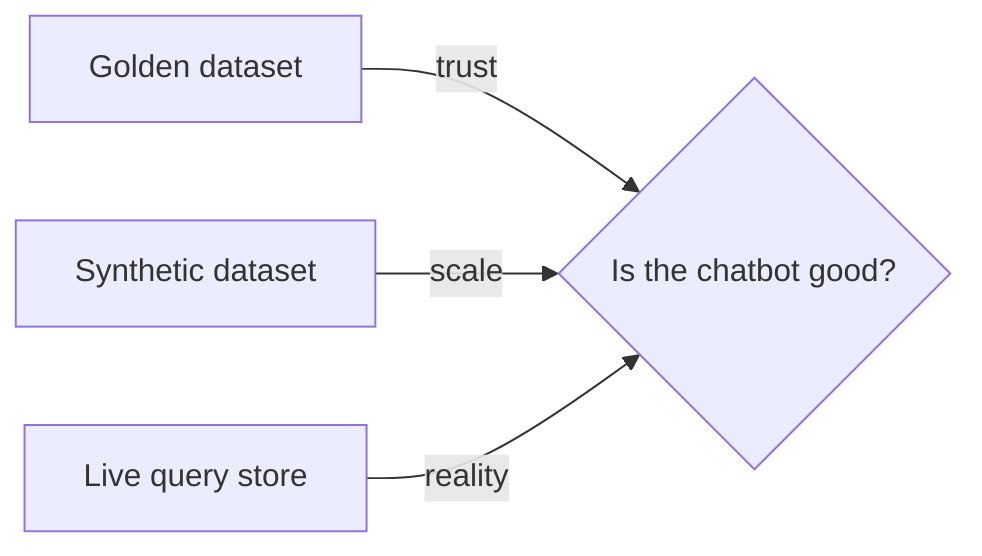
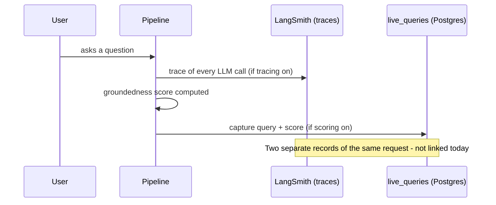

# Testing strategies: Golden, Synthetic, and Live-query datasets

A plain-language guide to the three different kinds of "test data" this
project uses to answer one question: **is the chatbot's answer actually
good?** Companion to [TESTING-GUIDE.md](TESTING-GUIDE.md), which covers the
pytest suite (does the *code* work) - this doc covers RAG *quality*
evaluation instead (does the *answer* work), a genuinely different concern.

## Overview - why three, not one

A single test set can't do everything:

- You need **trust** (is this expected answer actually correct?) → that
  needs a human.
- You need **scale** (hundreds of edge cases, not just the 20-30 you
  thought of) → a human can't write that many by hand cheaply.
- You need **reality** (what are people *actually* asking?) → neither of
  the above tells you that; only real traffic does.

No single dataset gives you all three, so this project keeps three
separate ones, each answering a different question.

## The three types

| | **Golden dataset** | **Synthetic dataset** | **Live query store** |
|---|---|---|---|
| Where it comes from | A human writes it, grounded in the real KB PDFs | Generated programmatically (LLM or script) | Real users, real production traffic |
| Is the "correct answer" trustworthy? | Yes - verified by a person | Not verified - generated, may itself be wrong | N/A - there's no pre-known "correct" answer, only a live quality score |
| How big can it get? | Small - a human has to write every case | Large and cheap - generate hundreds in minutes | As big as real traffic |
| Where it lives in this project | `resources/golden_dataset/*.json` → `golden_dataset_cases` table | `synthetic_dataset_cases` table | `live_queries` table |
| What decides, in code | `golden_dataset_harness.py` | `synthetic_dataset_store.py` | `maybe_capture_live_query()` in `eval_threshold.py` |

## What each one is actually for

**Golden dataset** - the CI gate. `scripts/run_release_gate.py` runs every
case through the real pipeline and issues a PASS/REVIEW/BLOCK verdict.
This is the one dataset allowed to block a deploy, because it's the one
dataset whose "correct answer" can actually be trusted.

**Synthetic dataset** - coverage at scale. A hand-written golden set might
have 20-30 cases; a synthetic set can cover hundreds of phrasings, edge
cases, and adversarial questions a person wouldn't think to write by hand.
Lower trust per case, higher breadth.

**Live query store** - the reality check. Real questions, scored by the
same live groundedness judge every production answer already gets. Only
queries scoring above a threshold (today: **0.6**, runtime-editable, not
hardcoded) get promoted to `is_ltm = true` - a curated pool of
real-world questions the system is already answering well, useful for
noticing what's actually being asked versus what was guessed at.

## Use case scenarios

| Scenario | Which dataset fits |
|---|---|
| "Did this code change break anything, before I merge?" | Golden dataset (CI gate) |
| "How does the bot handle 200 different phrasings of the same benefits question?" | Synthetic dataset |
| "What are employees actually asking that we never anticipated?" | Live query store |
| "I want a confident, hand-verified regression suite" | Golden dataset |
| "I want to stress-test retrieval across every policy document cheaply" | Synthetic dataset |
| "I want to know if real users are happy with real answers, continuously" | Live query store |

## Benefits, side by side

- **Golden**: highest trust, safe to gate a release on, small enough to review by hand.
- **Synthetic**: cheapest way to get volume; good for finding retrieval gaps a small hand-written set would miss.
- **Live query**: zero authoring cost (it writes itself), the only one that reflects real usage patterns, naturally grows over time.

## How this relates to LangSmith - a common mix-up, worth being precise about

**These three stores and LangSmith are two separate systems, not one.**
LangSmith (this project's tracing tool, see
[HANDOFF.md](HANDOFF.md)/this session's own LangSmith work) captures
*traces* - the step-by-step record of one request (every LLM call,
latency, tokens). The three stores on this page capture *questions and
their quality scores* - a different kind of record, held in this
project's own Postgres, viewed through its own Admin Dashboard, not
LangSmith's UI. For which *other* services across the platform have (or
don't have) LangSmith wired, and what tracing data does/doesn't support
for audit purposes, see the parent folder's own
[observability-governance.md](https://github.com/rvsree/hrb_emp_assist/blob/master/docs/observability-governance.md)
in the shared `hrb_emp_assist` repo.

They *can* be connected - LangSmith supports building a "Dataset" from
real captured traces (its own "add to dataset" feature), which is
conceptually similar to what this project's `live_queries` table already
does independently. **Today, nothing wires the two together** - the
`live_queries` capture is entirely self-contained, doesn't read from or
write to LangSmith. Worth knowing before assuming a trace you see in
LangSmith is the same row you'd see in the Admin Dashboard's Live Queries
tab - they're unrelated records of the same underlying request.

## Synthetic dataset - generation methodology (MVP-3, 2026-10-26)

How synthetic cases should actually get produced, once built - a
methodology, not yet the generator script itself (flagged below, out of
scope for this pass):

1. **Source material**: the real KB docs (`resources/kb_docs/`), the same
   ones the golden dataset is grounded in - never invented policy. The
   existing golden dataset cases serve as style/format seeds (same
   question shape, same level of specificity), not as content to
   paraphrase directly.
2. **Generation**: an LLM (cheap tier - `gpt-4.1-mini` or Anthropic Haiku,
   matching this project's own cost-conscious judge-model preference) is
   given one real KB chunk plus instructions to produce several varied
   questions answerable from that chunk - different phrasings, different
   specificity (a vague version and a precise version of the same ask), a
   numeric variant where the source has numbers, and a multi-part/compound
   variant.
3. **Trust boundary - the real risk**: a generated question's "expected
   answer" is not verified by a human, so synthetic cases should **never**
   be trusted the way golden-dataset cases are (see testing-strategies.md's
   own comparison table above). Before being written to
   `synthetic_dataset_cases`, each generated case should pass a cheap
   automated sanity check - DeepEval's existing `FaithfulnessMetric`
   (already wired in this project, see `evaluate_groundedness()`) run
   against the *source chunk* the question was generated from, discarding
   any case whose own generated answer isn't actually grounded in that
   chunk. This doesn't make synthetic cases "golden-grade," just filters
   out the obviously broken ones before they pollute the store.
4. **Storage**: `synthetic_dataset_store.upsert_case()` (already built,
   Phase 257) - same idempotent-by-`(case_key, dataset)` shape the golden
   harness already uses, so nothing new needed on the storage side.
5. **Cadence**: one-time or occasional batch runs, not continuous - unlike
   live-query capture, there's no reason to generate synthetic cases on
   every request.

**Out of scope this pass** (flagged, not built): the actual
`scripts/generate_synthetic_dataset.py` script - this section defines the
approach; writing the generator itself is its own later phase, following
`scripts/sync_golden_dataset.py`'s existing pattern once prioritized.

## Challenges

- **Golden**: expensive to grow - every new case needs a human to write and verify it. Stays small by nature.
- **Synthetic**: quality is only as good as whatever generated it - a bad generator produces a confidently-wrong dataset. Needs its own review step before being trusted the way golden is (not built yet - flagged in the roadmap).
- **Live query**: no "correct answer" to compare against, only a quality score - a confidently wrong answer that still *sounds* grounded can still get promoted to LTM. The threshold is a proxy for quality, not a guarantee.
- **All three**: none of them currently talk to each other automatically - promoting a good live query into the golden or synthetic set, for example, is a manual step today, not a pipeline.

## Where this stands today (2026-10-26)

| Piece | Status |
|---|---|
| Golden dataset - content, CI gate | Built, in active use |
| Synthetic dataset - storage layer | Built (Phase 257) |
| Synthetic dataset - generation methodology | Defined (above) - the generator script itself is a separate, later phase |
| Live query store - storage + capture + LTM gate | Built (Phase 257) |
| 30+ authored live test queries (RAG/HITL/state/conversational) | Built - `resources/live_test_queries/live-test-queries.md`, 40 queries |
| `expected_tool`/`expected_agent` on the golden dataset (routing-accuracy scoring) | Built (Phase 258) - 5 cases annotated, release gate extended to all 3 modes for the routing subset, plus a standalone `scripts/run_routing_accuracy_check.py` for cheap iteration |
| Admin UI to view all three | Built - `hrb_chatbot_ui`'s Admin Dashboard now has `/golden-dataset` (pre-existing, Phase 181), plus `/live-queries` and `/synthetic-dataset` (`hrb_chatbot_ui` Phase 1, 2026-10-26). |
| Settings UI to change the 0.6 threshold | Built - `hrb_chatbot_ui` Phase 1's Settings page, Memory sub-tab (`ltm_score_threshold`, runtime-editable, no redeploy) |
