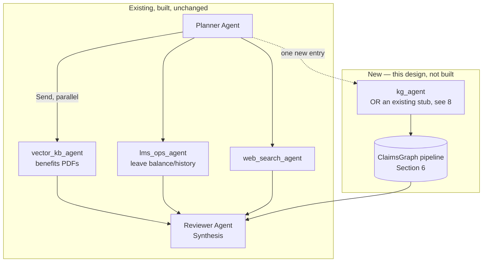
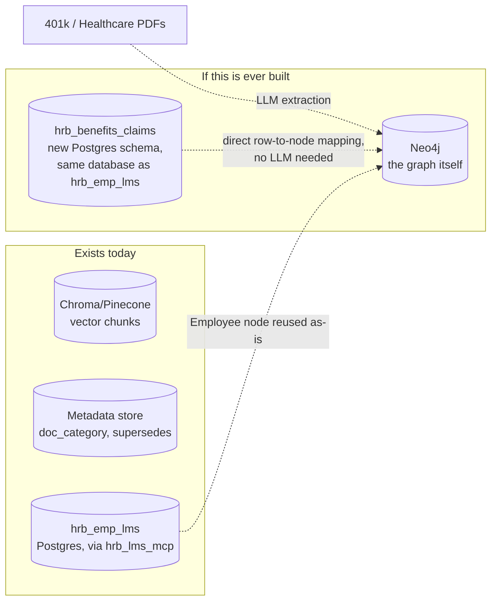
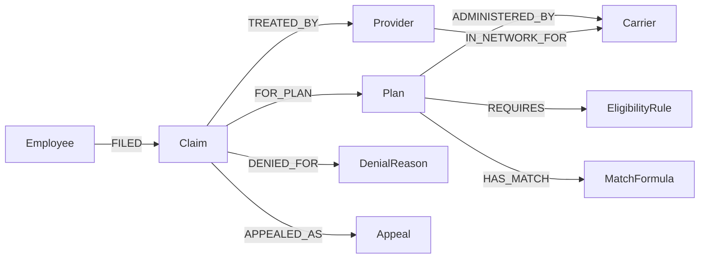
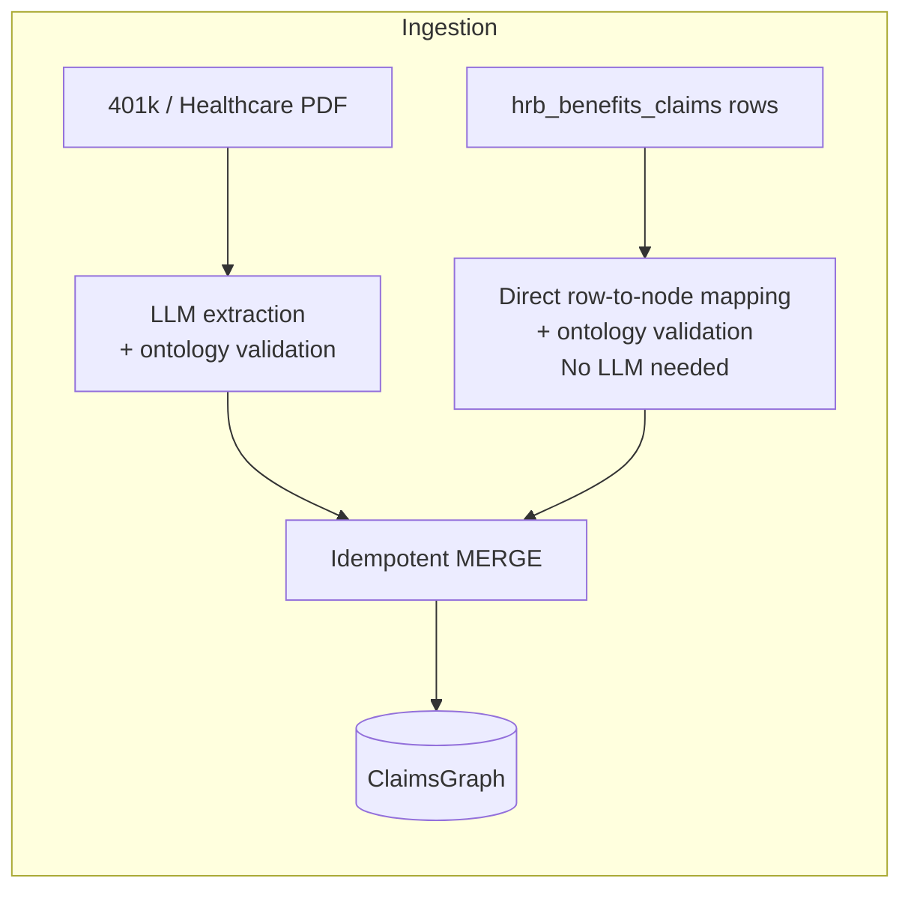
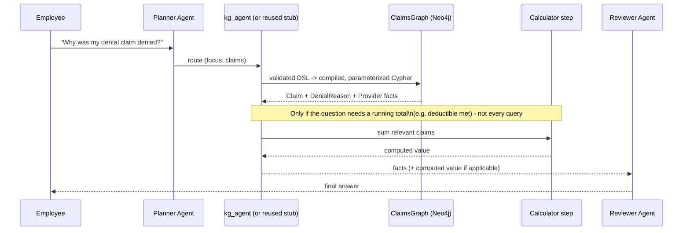
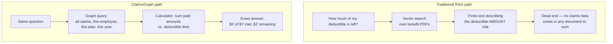

# ClaimsGraph — Insurance Claims Processing on a Knowledge Graph

**Status: design-level write-up, not an SDD `**Spec:**` block yet.** Nothing
here is built. This document is self-contained — it does not require
reading `readme-knowledge-graph.md` (the general knowledge-graph tutorial)
first. See **Section 9** for exactly what's blocking a real Spec, and
**Section 10** for a second, independent action item folded in from a
related conversation.

---

## 1. What this is, in one paragraph

**ClaimsGraph** is the name for one specific, scoped idea: represent
insurance claims (medical/dental/vision) as a knowledge graph — claims,
providers, plans, carriers, denials, appeals as connected facts — sitting
alongside this project's existing vector-search RAG and `hrb_lms_mcp` tool
calls, not replacing either. It is the one direction, out of everything
explored in the general KG document, judged strong enough to design in
detail: real carriers already named in the KB PDFs, real employee identity
already in `hrb_lms_mcp`, no new MCP service, no change to any existing
pipeline. IRA/ESPP and any wider new HR domains are explicitly out of scope
for this document.

---

## 2. The problem: why traditional RAG hits a wall here

This project answers benefits questions two ways today: vector search over
policy PDFs, and direct tool calls to `hrb_lms_mcp` for personal leave data.
Both work well for what they do. Neither can answer a **claims** question,
for a reason that has nothing to do with retrieval quality:

> **No claims data exists anywhere in this platform.** The healthcare PDF
> describes plan *rules* (what's covered, which carriers) — it has never
> seen an actual claim, denial, or payment, because that data is
> transactional, not documentary. Better chunking or a better embedding
> model cannot retrieve a fact that was never written down in any document.

Even once claims data exists somewhere, a second, separate problem shows up:

| Question | Why plain RAG (even with claims text available) struggles |
|---|---|
| "Why was my dental claim denied?" | Needs to join 3 separate facts (the claim, its denial reason, the provider's network status) — RAG retrieves text that *sounds* relevant, it doesn't *join* records. |
| "How much of my deductible have I met this year?" | Needs a **running sum across every claim filed this year** for that employee/plan. This is arithmetic, not retrieval — an LLM asked to eyeball a list of claims and add them up will occasionally get the sum wrong, silently. |
| "Did my last claim get the in-network rate?" | Needs a 2-hop traversal: claim → provider → provider's network status for that specific carrier. |
| "What's the appeal success rate for claims denied for [reason]?" | An aggregate across *all* claims matching a filter — not a single document's content at all. |

**The pattern:** these questions need exact, structured facts connected to
each other and, in one case, deterministic arithmetic on top of those facts
— not "text that sounds related." That is precisely what a knowledge graph
plus a small calculation step provides, and precisely what embeddings-based
retrieval cannot, no matter how good the chunking or retrieval tuning gets.
Section 5.3 shows this side by side as a diagram.

---

## 3. Where this fits today — confirmed against real code, not assumed

- **Real carriers already exist**, bundled in `AmazingBank_Healthcare_Benefits.pdf`: Medical (Aetna, Cigna, UnitedHealthcare, Centivo), Dental (MetLife, Delta Dental), Vision (VSP), Rx (CVS Caremark).
- **Real employee identity already exists**, in `hrb_lms_mcp`'s `hrb_emp_lms.employees` table — `employee_id`, `department`, self-referencing `manager_id`, `hire_date` — 50 employees, 5 departments, seeded today. ClaimsGraph reuses this node as-is; it does not duplicate it.
- **Real routing architecture already exists and is settled.** `ai/agents/workflow_agents/planner_agent.py`'s Planner classifies a question across 5 domain agents (`vector_kb_agent`, `lms_ops_agent`, `sql_db_agent`, `lms_analytics_agent`, `web_search_agent`); `multi_agent_pipeline.py` fans these out in parallel via LangGraph `Send()`; `reviewer_agent.py` synthesizes. This is Phase 64's Hierarchical pattern, recorded as **"final, not open for reconsideration."** ClaimsGraph does not need new routing infrastructure — see Section 8.
- **Two of the five domain agents are already-reserved stubs** matching this exact kind of data: `sql_db_agent` ("structured HR operational database lookups") and `lms_analytics_agent` ("aggregate/historical analytics across employees") both just return "not available yet" today, citing `RAG-ROADMAP.md`/`BACKLOG.md` as the tracked gap.

---

## 4. Architecture diagrams

### 4.1 System context — today vs. the ClaimsGraph addition



### 4.2 Data architecture — where the facts live



No new MCP service, no change to `hrb_lms_mcp`. `hrb_benefits_claims` would
be one more bounded-context schema in the same database `hrb_emp_lms`
already lives in — same "schema per context, no cross-schema FKs" pattern
this platform already uses elsewhere.

### 4.3 Ontology — node and relationship types



Full property list per node type:

```
Carrier:         carrier_id:STRING!, name:STRING!, category:STRING [Medical|Dental|Vision|Rx]
Plan:            plan_id:STRING!, type:STRING! [Medical|Dental|Vision|401k], tier:STRING
Provider:        provider_id:STRING!, name:STRING!, specialty:STRING, in_network:BOOLEAN
Claim:           claim_id:STRING!, date_of_service:STRING!, billed_amount:FLOAT!,
                 allowed_amount:FLOAT, paid_amount:FLOAT, status:STRING! [Submitted|Paid|Denied|Appealed]
DenialReason:    reason_id:STRING!, description:STRING!
Appeal:          appeal_id:STRING!, outcome:STRING [Upheld|Overturned], filed_date:STRING!
EligibilityRule: rule_id:STRING!, min_tenure_days:INTEGER, description:STRING!
MatchFormula:    plan_id:STRING!, match_percent:FLOAT, vesting_schedule:STRING   (401k only)
```

`Employee` is not redefined here — it's the real node sourced from
`hrb_lms_mcp` (Section 3), reused unchanged.

Deliberately **not** a stored node/property: deductible/out-of-pocket met
so far. That's a running sum over `Claim.paid_amount` for an
employee+plan+year, computed on demand — a stored fact here would drift out
of sync with the claims it's summarizing (see 5.3's calculator step).

---

## 5. Workflow diagrams

### 5.1 Ingestion



Claims data is already structured (CSV rows), so it skips LLM extraction
entirely and maps straight to nodes — the same reason structured CSV/XLSX
data skips vector search entirely in a RAG pipeline. PDFs still need LLM
extraction, since plan rules are prose.

### 5.2 Retrieval — a concrete example query



The LLM never writes raw Cypher. It picks a validated query shape (a DSL),
code compiles that deterministically into parameterized Cypher — prevents a
hallucinated field name or an adversarial question from ever reaching the
database as a literal string.

### 5.3 Traditional RAG vs. ClaimsGraph — same question, side by side



This is the concrete answer to "why build this": the two paths aren't
competing on retrieval quality — the RAG path structurally cannot reach the
answer no matter how well it's tuned, because the fact it needs was never a
document in the first place.

---

## 6. Sample data (real, already created)

Real CSV files exist at `resources/kg_sample_data/insurance_claims/` —
hand-authored, deliberately cross-referencing via `claim_id`/`provider_id`/
`employee_id`, using real carriers and real `hrb_lms_mcp` employee IDs:

| File | Rows | Content |
|---|---|---|
| `providers.csv` | 8 | Provider name, specialty, carrier network, in-network flag |
| `plan_limits.csv` | 7 | Per-carrier, per-plan-year deductible/OOP-max/annual-max |
| `claims.csv` | 12 | Individual claims — employee, provider, carrier, amounts, status, denial reason |
| `appeals.csv` | 3 | Appeals filed against denied claims, with outcome |

Nothing beyond these four files exists — no code, no database, no
ingestion job.

---

## 7. Where this would live if built

Today: plain CSV files (Section 6) — same convention as `resources/kb_docs/`
and `resources/golden_dataset/`. If ever ingested: a new `hrb_benefits_claims`
Postgres schema in the same database as `hrb_emp_lms` (Section 4.2) — no new
service, no new auth, `claims.employee_id` referencing
`hrb_emp_lms.employees.employee_id` by value, same deliberate
no-cross-schema-FK simplification already used elsewhere in this platform.

---

## 8. The one real routing decision

Section 3 confirmed the routing architecture (Planner → N domain agents →
Reviewer) needs **no new infrastructure** — adding ClaimsGraph is either:

- **A new 6th agent** (`kg_agent`) — one new `AgentName` entry, one new
  prompt line, one new node function shaped like every existing domain
  agent. Cleanest, purely additive.
- **Filling in an existing stub** — `sql_db_agent` or `lms_analytics_agent`,
  whose reserved descriptions already match this data.

Both are legitimate. This document does not decide between them — see
Section 9.

---

## 9. What's blocking a real `**Spec:**` block

This project's own SDD convention (`CLAUDE.md`) treats a `**Spec:**` entry
in `RAG-ROADMAP.md` as a commitment that opens real code changes — it
should resolve open questions, not carry them. These are still open, and
they're decisions for you, not something I should assume:

1. **Neo4j hosting** — Aura Free (hosted, free tier) vs. self-hosted. No default picked.
2. **`kg_agent` vs. stub reuse** (Section 8) — which path.
3. **Sample data sizing** — are 8–12 rows per file (Section 6) enough for a real learning exercise, or should they grow before anything reads them into a graph?
4. **Final node property list** (Section 4.3) — sketch-level today, not locked.
5. **Which service owns ingestion** — directly in `hrb_chatbot_service`, or via the separate `hrb_rag_ingestion_service` sibling (not reviewed in this document).

Once these are decided, the real `**Spec:**` block (context, data/API
contracts, user-visible behavior, failure modes, out-of-scope, open
questions — per `.claude/skills/spec-new/SKILL.md`'s template) can be
written directly from everything already scoped in Sections 1–8.

---

## 10. Action item, independent of ClaimsGraph: standardize an ontology-like metadata layer in the *existing* RAG pipeline

This came out of a separate conversation about whether "ontology" thinking
has value outside knowledge graphs entirely — it does, and it's a real,
verified gap in code that exists **today**, regardless of whether
ClaimsGraph is ever built:

- `ai/doc_processing/metadata_extraction/document_metadata_extractor.py`
  has an LLM free-text-extract `doc_category` (and 11 other fields) at
  ingestion — nothing validates the result against a fixed set.
- `ai/rag_pipeline/query_retrieval/retriever.py`'s `METADATA_FIELD_INFO`
  (Phase 20's `SelfQueryRetriever`) has a **second**, independent LLM guess
  a filter against the same field — its "allowed values" for `doc_category`
  exist only as a sentence inside a prompt, not enforced anywhere.
- These two LLMs can silently drift out of agreement about what
  `doc_category` means, breaking metadata filtering with no error raised.
- `common/enums.py` already has the exact convention needed (`StrEnum`
  for any field that should be a closed set, giving a clean 422 instead of
  silent fallthrough) — just never applied to content-classification
  fields, only to backend-selection ones (`VectorDB`, `LlmProvider`, etc.).

**Action:** promote `doc_category` (and consider a new `benefit_type`:
Medical/Dental/Vision/Rx/401k) to a real `StrEnum`, validate the
extractor's output against it at ingestion, and generate
`METADATA_FIELD_INFO`'s description from that same enum so there's one
source of truth instead of two. One honest wrinkle: `AmazingBank_
Healthcare_Benefits.pdf` bundles Medical+Dental+Vision+Rx in one document,
so a single scalar `benefit_type` per *document* would misclassify it —
either allow multiple values, or move tagging to chunk level (closer to
what retrieval actually filters on anyway).

This is small, uses no new library, needs no decision from Section 9, and
could get its own, much smaller Spec on its own — it doesn't need to wait
on any ClaimsGraph decision.

**Update, 2026-11-03: this now has a real Spec.** `RAG-ROADMAP.md` Phase
266 — ready to implement, no open questions. The "parent search" /
KG-routing question raised alongside it is tracked separately as Phase 267
— a decision-point phase, not a functional change, since it depends on
Section 9's still-open `kg_agent`-vs-stub-reuse question. Full write-up:
`readme-kg-rag-pipeline-impact.md`, in this same folder.

---

## 11. Bottom line

There's a real gap neither vector search nor `hrb_lms_mcp` covers:
transactional claims facts that need joining and, in one case, exact
arithmetic — not better retrieval. ClaimsGraph is the scoped, grounded
answer: real carriers, real employee identity, real sample data, settled
routing architecture, no new service. It is not yet a Spec because five
real decisions (Section 9) are still open — resolve those and the Spec
writes itself from what's already here. Separately, Section 10's metadata-
ontology fix is worth doing regardless of what happens to ClaimsGraph, and
is ready to spec on its own today.
