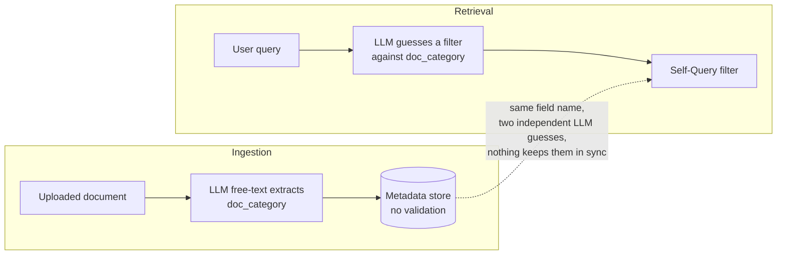
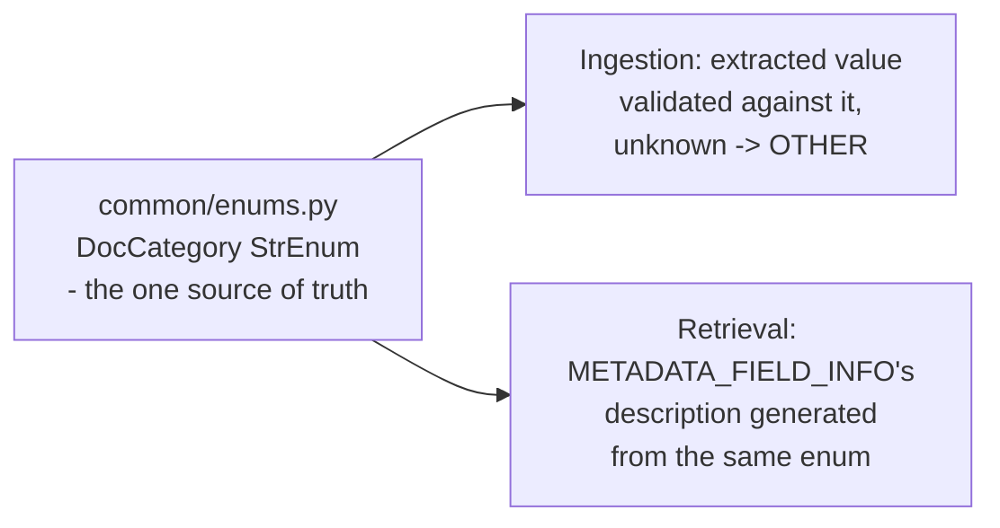
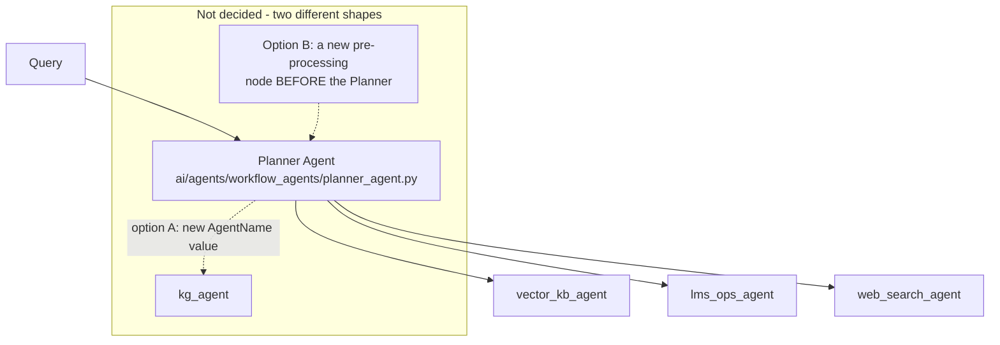

# Knowledge-graph impact on the existing RAG pipeline

**Status: two real phases now exist for this** — `docs/agent-reference/
RAG-ROADMAP.md` Phase 266 (ready to implement) and Phase 267 (a
readiness/decision-point phase, not yet a functional change). This
document is the detailed write-up both phases point back to.

Two separate things came out of exploring knowledge graphs
(`readme-claimsgraph.md`) and the standalone `claims_graph` learning
project: one is a real, independent gap in this pipeline today (Section
1); the other is a genuine open question about *if and how* a knowledge
graph would ever plug into this pipeline (Section 2) — they are not the
same size of decision, and this document keeps them separate on purpose.

---

## 1. Ontology-validated metadata (Phase 266 — ready now)

### 1.1 The gap, confirmed in code

`document_metadata_extractor.py` and `retriever.py`'s `METADATA_FIELD_INFO`
each have their own private idea of what `doc_category` can be — one as a
free-text LLM extraction with no check, the other as a sentence inside a
prompt. Drift between them breaks metadata filtering silently, with no
error anywhere.

### 1.2 The fix

Full contract in `RAG-ROADMAP.md` Phase 266. No endpoint shape changes, no
new library, ready to implement as scoped — the only reason it's being
tracked here instead of just in the roadmap is so the reasoning (why this
matters, how it was found) doesn't get lost inside a terse spec bullet.

---

## 2. KG-routing readiness ("parent search") — Phase 267, a decision point, not a build

### 2.1 Why this is a different kind of phase

Phase 266 fixes something that's broken *today*, independent of any
knowledge graph. Phase 267 is about whether and how a future knowledge
graph (if `claims_graph` is ever integrated here, which is explicitly
undecided — see `readme-claimsgraph.md` §8/§9) would need a query
pre-processing step to decide "does this question need multi-hop graph
reasoning, or does today's vector search handle it fine."

### 2.2 Why this isn't written as a committed design

Writing a committed routing design today would mean specifying how to
route to something that doesn't exist (`claims_graph`'s core phases
haven't landed) and picking between two materially different shapes
(a new Planner `AgentName` vs. an earlier pre-processing node) without the
information a real KG build would surface. That's exactly the "guess
dressed up as a decision" pattern this whole exploration has been trying
to avoid. Phase 267 exists to make the open questions visible and tracked
— not to resolve them prematurely.

### 2.3 What would actually need to be true first

- `claims_graph`'s own core phases (0-6) built and working, independent of this repo.
- An explicit decision that integration is wanted at all (today: an unscheduled stretch goal, not committed).
- The `kg_agent`-vs-stub-reuse decision (`readme-claimsgraph.md` §8).
- Neo4j hosting, decided in `claims_graph`'s own repo regardless of this question.

---

## 3. Relationship to `claims_graph`

`claims_graph` (`C:\workspace\2026-v1\interview-kickstart\claims_graph`) is
a separate, standalone project — this document does not create any
coupling. Nothing here reads from or writes to that project; it exists
purely to track, in this repo's own process, the two things that project's
exploration surfaced that are relevant to this repo specifically.
