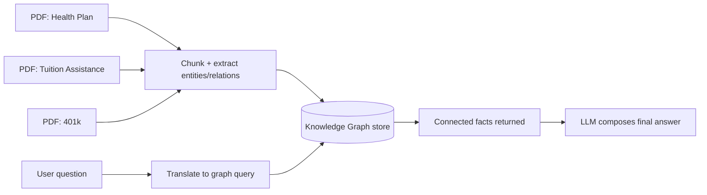
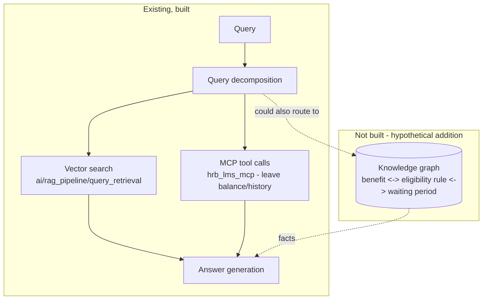

# Knowledge Graphs — What They Are, and the Basics Worth Knowing

**Status: this document is exploratory only — the general KG tutorial.**
Nothing described here is built. No code in this repo builds, reads, or
queries a knowledge graph. This covers what a knowledge graph is, how one
gets built, the libraries involved, the real challenges, and what's worth
learning from a real Udemy course project (Section 10).

**The one concrete use case this project is actually designing in detail —
insurance claims processing, named `ClaimsGraph`, with its own problem
statement, architecture diagrams, workflow diagrams, and a direct
comparison against traditional RAG — now lives in its own document:
[readme-claimsgraph.md](readme-claimsgraph.md).** That document also covers
why the domain was narrowed to claims specifically, the sample data, the
schema, and a separate, independent action item about standardizing
ontology-like metadata validation in the *existing* RAG pipeline. This
document stays scoped to the general tutorial (Sections 1-10) only.

---

## 1. The problem, in plain language

This project answers employee benefits questions two ways today:

1. **Vector search** (policy documents) — a question gets turned into a
   number (an embedding), and the system finds document chunks whose
   embeddings are "close" to it. This is `ai/rag_pipeline/query_retrieval/
   retriever.py` — similarity or MMR search over Chroma/Pinecone.
2. **Direct lookups** (your own data) — leave balance, leave history — a
   tool call to `hrb_lms_mcp`, which hits a normal Postgres table.

Both are good at what they do, but neither is good at **multi-hop
relationship questions** — questions that need you to connect several
separate facts together. For example:

> "Which of Amazing Bank's benefits require 90 days of employment before
> I'm eligible?"

Today, that question has to be answered by:
- Retrieving chunks from several *separate* PDFs (401k, healthcare, PTO,
  tuition, two unpaid-leave docs) that each mention eligibility separately,
- Hoping the vector search happened to retrieve the *right* chunk from
  *each* document,
- Then having the LLM read all of them and piece the answer together itself.

Nothing in the system actually *knows* "these 6 documents each have an
eligibility rule, and here's what each one says" as a fact it can look up
directly. That's the problem a knowledge graph solves: representing facts
and their relationships explicitly, so you can query them directly instead
of hoping similarity search surfaces the right text.

---

## 2. What a knowledge graph actually is

A knowledge graph stores information as:

- **Nodes** — things (entities): a benefit, a document, an employee, a rule.
- **Edges** — relationships between things: "requires", "supersedes",
  "eligible for", "belongs to".

```
(Employee) --[enrolled in]--> (Health Plan)
(Health Plan) --[has]--> (90-Day Waiting Period)
(Tuition Assistance) --[requires]--> (90-Day Waiting Period)
```

The difference from a normal database table: relationships are **first-class
and traversable**. "Give me every benefit connected to a waiting period of
90 days or less" is one graph query (a *traversal*), not a multi-table SQL
join you have to hand-write for every new question shape.

The difference from vector search: a graph gives you **exact, structured
facts** ("X requires Y"), not "text that sounds related to X." Vector search
answers "what does this sound like"; a graph answers "what is actually
connected to what."

**Important distinction, so this doesn't get confused with what already
exists here:** the leave/employee data in `hrb_lms_mcp`'s Postgres tables is
*relational*, not a graph — plain tables with foreign keys, queried with
SQL. That's not a knowledge graph. Neither is the simple `supersedes` /
`superseded_by` / `is_current` pointer chain already in this project's
document metadata (`services/documents_service.py`) — that *is* technically
a tiny graph relationship (one document points to another), but it's stored
as plain columns in a relational metadata store, not a graph database, and
it only has one relationship type. More on that in Use Case 2 below.

---

## 3. How it works, step by step

Building a knowledge graph from documents (rather than hand-entering facts)
has three stages:

1. **Extraction** — read the source text and pull out entities and
   relationships. Done either with:
   - Traditional NLP (Named Entity Recognition, e.g. spaCy) — fast, cheap,
     but only finds entity *types* it was trained to recognize (people,
     orgs, dates) — not domain concepts like "eligibility rule."
   - An LLM, given a schema and asked to extract `(entity) -[relation]->
     (entity)` triples from each chunk. Slower and costs tokens per
     document, but understands domain-specific concepts ("this sentence
     describes an eligibility rule") without being trained for it. This is
     what LangChain's `LLMGraphTransformer` does, and what this project
     would realistically use, since it already has an LLM in the loop for
     every other pipeline stage.
2. **Storage** — the extracted triples get written into a graph store.
3. **Query** — a question gets translated into a graph query (either a
   fixed traversal pattern, or an LLM-generated query against the graph's
   query language), the graph returns exact connected facts, and those
   facts get handed to the LLM to phrase as a normal answer — same
   "retrieve, then generate" shape this project's RAG pipeline already
   uses, just with a graph as the retrieval source instead of (or
   alongside) the vector store.



This pattern — vector search for "what sounds relevant," graph traversal
for "what is actually connected," both feeding the same LLM — is commonly
called **GraphRAG**.

---

## 4. Underlying libraries and databases (real, named, nothing invented)

| Piece | Option | What it actually is |
|---|---|---|
| Graph database | **Neo4j** | The standard dedicated graph database. Has a free "Aura Free" hosted tier. Query language: Cypher. |
| Graph database (no server) | **NetworkX** | A pure-Python, in-memory graph library — no separate database to run. Good for a small graph (hundreds of nodes), bad for anything that needs to persist/scale/be queried concurrently. |
| Extraction | **LangChain's `LLMGraphTransformer`** | Takes text + an LLM, outputs `(node)-[relationship]->(node)` triples. Already fits this project, since LangChain is already the chosen library for chunking/indexing/retrieval here — this would not be a new framework decision, just a new LangChain module. |
| Extraction (alternative) | **spaCy** (NER only) | Finds generic entities (people, dates, orgs). Would not understand "eligibility rule" or "waiting period" as concepts without custom training — not a good fit for this project's domain-specific needs. |
| Query | **Cypher** (if Neo4j) | Neo4j's graph query language — conceptually like SQL, but for traversing relationships instead of joining tables. |

**None of these are installed or imported anywhere in this repo today.**
Per this project's own standing rule (no new library without explicit
review), none of this should be added without that conversation happening
first — this table is informational, not a recommendation to install
anything.

---

## 5. Architecture: how it would sit next to what already exists



It would **not** replace vector search or the MCP tool calls — it would sit
alongside them as a third retrieval path, used only for questions that are
actually about relationships between benefits (eligibility, waiting
periods, document lineage), while plain "what does the PTO policy say"
questions keep using vector search exactly as they do now. This matches the
project's existing pattern of multiple retrieval strategies behind one
decomposition/routing step — see Section 14.6 for exactly what that
routing step looks like in this project's real code today.

---

## 6. Challenges (honestly, not glossed over)

- **Extraction quality.** An LLM extracting "entity → relationship → entity"
  from a benefits PDF can get the relationship wrong or miss it entirely —
  there's no automatic way to know the graph is complete or correct without
  a human checking it, at least at first.
- **Schema design is real work.** You have to decide, up front, what counts
  as an entity type (`Benefit`? `EligibilityRule`? `WaitingPeriod`?) and
  what relationships are allowed between them. Get this wrong and the graph
  becomes inconsistent as more documents are added.
- **Keeping it in sync.** Every time a benefits PDF is re-uploaded (this
  project already supports document supersession), the graph has to be
  re-extracted or patched — another moving part alongside the existing
  chunk/embed/index pipeline.
- **A second infrastructure dependency.** A real graph database (Neo4j) is
  another service to run, monitor, and pay for, on top of the vector DB and
  Postgres this project already runs. For a knowledge base this small (6
  documents today), that cost may not be justified yet.
- **It's additive, not a replacement.** It solves a narrow class of
  questions (relationship/multi-hop) and does nothing for everything
  vector search already handles well — easy to over-invest in for the
  wrong reason ("this sounds more advanced").

## 7. Learning curve

- **If you already understand this project's RAG pipeline:** the
  *concept* (retrieve → generate) carries over directly, so that part is
  not new.
- **What's actually new to learn:** graph data modeling (nodes/edges/
  properties — a different mental model from documents or SQL rows), and
  a query language (Cypher, if using Neo4j) that's unlike SQL in how it
  expresses relationships.
- **Realistic estimate:** a few focused days to get a toy graph working
  end to end (extract → store → query) using a short course below; longer
  to design a schema you'd trust for real benefits data.

## 8. Quick learning resources (real, current, free)

- **Neo4j GraphAcademy** — free, hands-on, browser-based courses on graph
  concepts and Cypher. `https://graphacademy.neo4j.com/`
- **"Knowledge Graphs for RAG"** — a short course by DeepLearning.AI, built
  with Neo4j, specifically about the GraphRAG pattern described above.
  `https://www.deeplearning.ai/short-courses/knowledge-graphs-rag/`
- **LangChain's own graph tutorial** — shows `LLMGraphTransformer` and
  querying a graph from LangChain, the most directly relevant one given
  this project already uses LangChain. `https://python.langchain.com/docs/tutorials/graph/`
- **Microsoft's GraphRAG project** — a real, open-source reference
  implementation of the extraction → graph → retrieval pattern, useful to
  read even without using it directly. `https://github.com/microsoft/graphrag`
- **NetworkX docs** — if just experimenting without standing up a real
  database. `https://networkx.org/`

---

## 9. Use cases, grounded in this project's actual data

### Use case 1 — Cross-document eligibility reasoning

**The real documents in `resources/kb_docs/` today:**
`AmazingBank_Empower_401k_Savings_Plan.pdf`,
`AmazingBank_Healthcare_Benefits.pdf`,
`AmazingBank_Paid_TimeOff.pdf`,
`AmazingBank_Guild_Tuition_Assistance.pdf`,
`AmazingBank_Unpaid_TimeOff.pdf`,
`AmazingBank_Sedgwick_Unpaid_Timeoff.pdf` — 6 documents, each with its own
eligibility/waiting-period language.

**Question:** *"Which benefits can I use within my first 90 days?"*

- **Today:** the retriever searches each document independently by
  similarity; there's no guarantee all 6 eligibility mentions get retrieved
  together, and nothing confirms the answer is complete.
- **With a small graph** (just ~6 `Benefit` nodes, ~6 `EligibilityRule`
  nodes, one `requires` edge each — well under 20 nodes total, a genuinely
  small graph for this KB size): one traversal — "all Benefits connected
  to an EligibilityRule where `min_tenure_days <= 90`" — returns every
  match, guaranteed, not "whatever got retrieved."

### Use case 2 — Document lineage (something this project already half-has)

`services/documents_service.py` already tracks `supersedes` /
`superseded_by` / `is_current` per document — confirmed in the code, not
hypothetical. This is already a one-relationship-type graph, just stored
as plain columns instead of a graph.

**Question:** *"What's the full version history of the healthcare benefits
document — every version, in order?"*

- **Today:** this requires manually walking the `supersedes` chain
  backward, one `get_document()` call at a time, in application code.
- **As a graph:** a single traversal ("follow every `supersedes` edge from
  this node") returns the whole chain in one query, however long it is —
  this is the one use case here where the project already has graph-shaped
  data; it just isn't stored or queried as a graph yet.

### Use case 3 — Combining the policy graph with personal data (maps to an existing UI capability)

The chatbot's own "Combine policy and your own data" feature (Multi-Agent
RAG mode, already shipped in `hrb_chatbot_ui`) already handles questions
like *"What is my current leave balance, and what is Amazing Bank's sick
leave policy?"* by calling both the MCP tool (personal data) and the vector
store (policy) and combining the two answers.

**A graph would extend this**, not replace it, for the eligibility-specific
version of that same pattern:

**Question:** *"Am I eligible for tuition assistance yet?"*

This needs: `Employee(hire_date)` [from `hrb_lms_mcp`, real relational
data] → compute tenure → compare against →
`TuitionAssistance -[requires]-> EligibilityRule(min_tenure_days)` [from
the hypothetical graph]. Today, the LLM has to hold both facts in its own
reasoning and get the comparison right itself, every time, from scratch.
With the rule stored as an explicit graph edge, the comparison is a
direct lookup instead of something the LLM has to re-derive per question.

---

## 10. Basics, re-taught through a real course project — and what's actually worth leveraging here

Reviewed a real, working Udemy course project (`C:\Users\sreed\Downloads\knowledge-graph-project`
— a Revenue Intelligence chatbot for an IT consulting firm, built on
FastAPI + Neo4j + ChromaDB) purely as a teaching example. Nothing from it
is adopted here. The goal of this section: restate the basics simply using
its real code as the example, then be honest about which pieces would
actually earn their place in *this* project versus which ones are solving a
problem this project doesn't have yet.

### 10.1 The basics, in plain language

A knowledge graph stores facts as **nodes** (things — a benefit, a document)
connected by **edges** (relationships — "requires", "supersedes"). Building
one from documents is three steps: (1) an LLM reads the text and pulls out
`(thing)-[relationship]->(thing)` facts, guided by a schema you define up
front (an **ontology** — what kinds of things and relationships are
allowed); (2) those facts get written into a graph database (Neo4j is the
standard choice); (3) a question gets turned into a graph query, the graph
returns exact connected facts, and an LLM phrases them as an answer — the
same "retrieve, then generate" shape this project's RAG pipeline already
uses, just with a graph as the retrieval source.

### 10.2 Concepts worth knowing, and whether they're worth leveraging here

| Concept | What it is, simply | Leverage here? | Why |
|---|---|---|---|
| Competency Questions (CQ) — write the real questions *before* designing any schema | A short list of plain-English questions the graph must answer; every node/relationship must trace back to one | **Yes, as a method, anytime** | Costs nothing, prevents designing a schema nobody needs. This project's own use cases (9.1–9.3) are already informal CQs — just name the habit. |
| Ontology (schema) — node types, relationship types, required fields, allowed values | The "shape" the graph is allowed to have | **Only once there's a real use case** | Designing it well is real work (Section 6) and only pays off against actual questions, not hypothetical ones. |
| LLM-based extraction + a validation layer | LLM pulls out facts; a hardcoded check drops anything that doesn't match the schema before it's written | **Yes, if this is ever built** | Simple, cheap insurance — never trust the LLM's JSON output directly. |
| Entity resolution (as done here: exact-key merge, not fuzzy matching) | Same real-world thing, written slightly differently, gets merged by an exact ID match only | **Not a real gap for this project yet** | With 6 small, clean PDFs there's no messy "same thing, different spelling" problem to solve — this limitation wouldn't even surface here. |
| Idempotent writes (`MERGE`) | Re-running extraction on an updated document updates the existing node instead of duplicating it | **Yes, if this is ever built** | Matches this project's existing document-supersession pattern; a graph without this would get corrupted on every re-upload. |
| Constrained query generation (LLM → validated DSL → compiled, parameterized query — never raw Cypher from the LLM) | A safety pattern: the LLM picks *what* to ask for, code deterministically turns that into *how* to ask the database | **Yes — the one idea worth remembering regardless of graph or not** | Prevents a hallucinated field name or an adversarial question from ever reaching the database as a literal query string. Useful even for plain tool calls, not just graphs. |
| Hybrid routing (vector vs. graph vs. both, via a planner + LangGraph) | One node decides which retrieval path(s) a question needs | **Already have the machinery** | `multi_agent_pipeline.py` already runs a LangGraph graph for `multi-agentic-rag` — a graph retrieval path would be one more node in a shape that already exists, not a new mechanism. |

### 10.3 Benefits, limitations, and challenges — short version

- **Benefit:** answers multi-hop, "connect several facts together" questions
  exactly and completely, instead of hoping similarity search happened to
  retrieve the right chunks (the real gap described in Section 1).
- **Limitation:** it only helps that one class of question. Plain "what does
  the PTO policy say" questions get no benefit from a graph at all.
- **Challenge:** schema design and extraction quality both take real,
  ongoing effort (Section 6) — a graph is never "set and forget."
- **Challenge:** a second database (Neo4j) is new infrastructure to run,
  monitor, and pay for, on top of what already exists.

### 10.4 The technique worth copying: small, deliberately-interconnected synthetic data

The course project's CRM/project/revenue CSVs are hand-authored and tiny
(6–10 rows per file) but deliberately cross-referencing — every account
links to an opportunity, a sales rep, an industry, a loss reason. That's
the real trick: a rich multi-hop use case doesn't need *big* data, it needs
a handful of entity types wired together on purpose. The author invented a
believable-but-fake CRM from scratch specifically to make "Why are deals
being lost?" answerable by a graph. This project doesn't need to wait for
real data to arrive either — `readme-claimsgraph.md`'s own sample claims
dataset (real files, Section 6 of that document) uses exactly this
technique.

---

## 11. Where the domain-growth reasoning and the detailed design moved

Sections that used to live here — growing into new adjacent HR domains
(and the decision to set that aside), going deep into claims specifically,
the sample data, schema, pipeline diagrams, and architecture diagrams — are
now entirely in **[readme-claimsgraph.md](readme-claimsgraph.md)**, so this
document stays a pure "what is a KG, how does one get built" reference.

---

